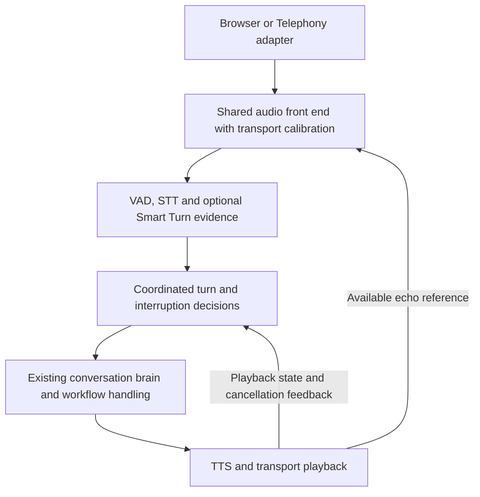

# EchoSphere Turn Detection: Proposed Approach for Independent Review

**Status:** Draft proposal. Awaiting independent review and the owner's decision.

**Prepared:** 2026-11-26, Asia/Kolkata.

**Current local source reference:** `159fe60a714f67232e12b76a63f1edcc9f1be051`.

**Historical audit reference:** 2026-11-24, source revision `4ac6db530d39510c47f1af2b255dca0355629174`.

**Authorization:** This document requests review only. It does not authorize implementation, configuration changes, database migrations, service operations, test calls, or deployment. The owner will decide what to do after reviewing Claude's feedback. The workspace rule prohibiting live code changes remains in force; any subsequently authorized implementation must be developed and tested locally.

## 1. Recommendation and decisions requested

Use **one shared turn-handling implementation for all tenants**, with shared default behavior, transport-specific audio calibration, and optional bounded tenant overrides.

Keep Browser and Telephony as distinct audio profiles. Do not maintain separate conversational engines for them. A tenant's identity should not determine the speech-detection algorithm; actual audio conditions, provider capabilities, language support, and conversation context should determine applicable behavior.

The proposed work is a staged improvement to the existing implementation. A complete rewrite is not justified by the evidence collected so far. Existing components already share substantial logic and should be retained wherever they satisfy the required contracts.

The owner and reviewer should decide:

1. Whether this separation of shared behavior, audio calibration, and provider capabilities is correct.
2. Whether targeted corrections are sufficient, or whether particular decision boundaries need refactoring.
3. Which tenant overrides are necessary and who should be allowed to change them.
4. Which behavior changes require an explicit new policy/profile version.
5. What labelled evidence and acceptance criteria are required before selecting new preset values.

No replacement numeric preset is approved by this proposal.

## 2. What already exists

The current application is not a collection of independent engines per tenant or channel.

| Existing component | Relevant behavior |
| --- | --- |
| `shared/turn_detection.py` | One schema defines fields, bounds, Default/Recommended values, validation, and effective configuration resolution. It currently has 43 fields across Browser and Telephony. |
| `shared/bot_config.py` | Resolves tenant settings into the per-call configuration snapshot. |
| `voice_runtime/pipeline.py` | Builds the shared audio pipeline and selects transport parameters and provider-specific strategies. |
| `voice_runtime/audio_gate.py` | Implements the caller audio gate and noise-floor tracking. |
| `voice_runtime/smart_turn.py`, `turn_stop.py` | Supply audio-model and bounded-timeout stop strategies. |
| `voice_runtime/barge_in.py`, `caller_level.py` | Implement interruption confirmation and relative caller-level evidence. |
| `voice_runtime/brain.py` | Buffers transcripts, handles lexical shortcuts and finalization, coordinates conversation generation and recovery. |
| Tenant Turn Detection API and Studio UI | Store tenant-wide settings with independent transport overrides. The bot-specific page URL does not make these settings bot-specific. |

Fresh runtime snapshots use the resolved tenant map. Legacy per-bot STT tuning is a compatibility fallback for older snapshots/direct callers; this proposal does not add another per-bot configuration layer.

The browser capture code requests echo cancellation. The current phone path processes 8 kHz audio. These implementation differences justify retaining separate audio profiles, but do not establish that every conversation timing value must differ by channel.

Existing calls retain their resolved settings. New sessions obtain their settings through configuration resolution and cache invalidation. Preserve this behavior.

## 3. Evidence and its limits

### 3.1 Historical audit observations

These observations describe the 2026-11-24 audit, not the present state of demo or production:

- Thirteen relevant source-file hashes matched between local and demo at that time.
- The local and demo databases both stored Custom profiles, with different overrides.
- The demo phone snapshot used a 14 dB noise-floor margin versus the schema's 8 dB Default/Recommended value, enabled background and held-segment guards, and used a 6-second first silence prompt, 6-second retries, and two prompts.
- A shared implementation and matching source files did not imply matching effective settings.

| Historical sample | Calls | Measured turns | VAD-stop to dispatch, median / p95 | VAD-stop to first reply audio, median / p95 |
| --- | ---: | ---: | --- | --- |
| Phone, mixed historical settings | 58 | 627 | 207.7 / 1,706.0 ms | 1,942.7 / 4,305.3 ms |
| Browser, mixed historical settings | 2 | 6 | 185.6 / 735.9 ms | 1,920.9 / 3,270.2 ms |
| Calls started after the last observed settings update | 3 | 25 | 222.2 / 1,210.1 ms | 2,089.8 / 3,400.6 ms |

Important limitations:

- These are observational samples, not a controlled A/B comparison.
- The historical documents did not contain a complete effective Turn Detection profile for each call. Starting after a settings update is not proof of the exact profile used.
- VAD-stop timestamps occur after VAD speech-end confirmation. They are not manually labelled acoustic word-end timestamps.
- Nine phone timing records had a final-transcript timestamp after dispatch; fourteen had an endpoint span above five seconds. Late, merged, or held input may affect attribution. These records need timeline review before causal conclusions are drawn.
- Median classification time was approximately 1.27 seconds on the historical phone sample. Overall response latency cannot be attributed entirely to endpointing. Medians from different populations must not be subtracted to infer stage costs.
- The browser sample is too small to justify browser preset changes.

### 3.2 Offline replay and tests

- An isolated Silero replay used twenty existing post-gate audio clips. Default detected speech in fifteen clips; Recommended detected speech in fourteen. These counts are not accuracy or caller-recall scores because most speaker labels remain unverified and full-call context was reset.
- A recorded-evidence background-policy replay contained one confirmed background clip and no verified genuine-interruption positive set. With background enforcement enabled and a 12 dB bot-audio allowance, that background clip still passed. A 6 dB allowance trial blocked it, but did not establish acceptable genuine-caller recall.
- The effective relative-level margin while the bot speaks was 12 + 12 = 24 dB in that policy. The confirmed background sample was 19.7 dB below the trusted caller level, so it remained inside the acceptance margin.
- The policy replay did not rerun the full WAV through VAD, STT, the transport, and the conversation controller. A 6 dB allowance is an experiment, not a validated production recommendation.
- The historical focused checks reported 427 backend tests passed, 31 UI/JSON tests passed, and one optional backend test skipped. Deprecation and pending silence-task teardown warnings remained. Those tests were not rerun for this documentation-only change and are not a validation of the current source revision or this proposed architecture.

The available evidence supports further work and controlled evaluation. It does not prove that either preset is universally correct, or that the entire engine must be replaced.

## 4. What should be shared and what may vary

| Concern | Shared responsibility | Allowed variation |
| --- | --- | --- |
| Turn lifecycle | Common event contract, state transitions, cancellation, stale-event handling, and action deduplication | Provider capabilities determine which component supplies authoritative boundaries. |
| Utterance completion | Common distinction between physical speech, a final STT segment, and a complete conversational thought | Supported models, language, task context, and measured timing may affect the applicable policy. |
| Interruption | Common confirmation and cancellation contract | Bounded sensitivity/timing tuning where supported and validated. |
| Audio normalization | Common adapter interface | Codec, sample rate, packetization, buffering, and supported transport features. |
| Noise and echo handling | Common implementation and evidence definitions | Transport/device calibration, noise floor, echo characteristics, and validated thresholds. |
| No-response policy | Common implementation and default behavior | Tenant use case, such as allowing time to find a document or read an identifier. |
| Settings and validation | Common schema, bounds, capabilities, and resolution rules | Optional tenant overrides within those rules. |
| Runtime observations | Common metrics and reason codes | Per-call measurements and state, isolated from other calls and tenants. |

Every tenant should be able to run on the platform baseline without manual tuning. Tenant overrides are an exception for a demonstrated requirement, not a mandatory setup exercise.

A quiet browser call and a noisy browser call can differ more than a quiet browser and a quiet phone call. Transport is an initial calibration choice, not a reliable label for audio quality or speaker identity.

## 5. Proposed responsibility boundaries

The following is a conceptual responsibility map, not a requirement to create new services or replace existing classes:



### 5.1 Audio front end

- Normalize input and timestamp conventions through the transport adapter.
- Keep audio buffering and caller-level measurement separate from conversation meaning.
- Preserve speech onset with appropriate buffering. Do not assume gate confirmation and VAD-start windows can simply be added to calculate user-visible delay.
- Do not treat energy or relative loudness as verified speaker identity. A loud background speaker can pass an amplitude-based policy.
- Explicitly evaluate whether audio gating removes evidence needed by STT or a provider-owned detector.
- Preserve continuous-stream and keepalive behavior where required by the provider.

### 5.2 Turn and interruption coordination

Use the existing `UserTurnProcessor`, strategies, and brain where possible. The objective is to make action ownership explicit, not to add another competing controller.

Define one authoritative owner for each action in a call: committing a turn, dispatching a response, committing an interruption, and cancelling playback/generation. These responsibilities may span existing components, but each action must have one agreed decision boundary and be idempotent.

Required invariants:

1. A final STT segment alone is not proof that the caller finished their entire thought.
2. A timer, final transcript, or model verdict from an earlier speech episode must not close or interrupt a newer episode.
3. Resumed speech must invalidate incompatible pending endpoint decisions. Delayed inference must be checked against current speech state before acting.
4. Multiple qualifying signals must not independently produce duplicate responses or duplicate workflow effects. Preserve late-final recovery and existing action deduplication.
5. Speculative computation may be discarded; committing stale computation or replaying stale audio is unacceptable.
6. No-response reminders should run only when the bot is genuinely waiting, with no accepted turn or generation pending. Suppressed noise must not count as meaningful caller input.
7. Call shutdown and cancellation must clean up pending timers and tasks.

Review the existing boundaries before deciding whether extracting a coordinator is necessary. Targeted corrections may satisfy these invariants with a smaller change.

### 5.3 Separate completion from interruption

Ending the caller's turn and interrupting a bot reply are different decisions. They should share speech evidence and timestamps, while keeping their own explicit policy conditions.

For interruption, account for the pending question, recent caller speech, stable transcript evidence, bot playback state, and the relevant background/echo evidence. Avoid either assumption that every one-word input is noise or that every recognized word should cancel playback.

Examples requiring explicit tests include `yes`, `no`, `haan`, `nahi`, `ruko`, `stop`, acknowledgements during a long reply, recording announcements, and genuine speech overlapping bot audio. Language-specific terms should follow existing language/context abstractions rather than tenant-specific strings in core code.

### 5.4 Provider ownership is independent of transport

The current pipeline already distinguishes locally managed turns from provider-owned modes, including its `ExternalUserTurnStrategies` branch. Preserve this distinction.

- Declare whether a provider supplies authoritative turn boundaries, interim transcripts, explicit flush support, and relevant interruption signals.
- Do not let a local Smart Turn result and a provider event independently dispatch the same turn.
- Do not automatically add local pause waits to an authoritative provider completion event.
- Mark settings that are unsupported in the selected provider mode as inapplicable. Do not present a saved toggle as effective when the runtime cannot honor it.
- Missing finals, inference failures, provider timeouts, and reconnects need explicit bounded fallback behavior.

One shared engine means consistent application contracts. It does not mean every provider must use the same local detector.

## 6. Configuration and profile policy

### 6.1 Proposed resolution model

```text
Selected platform profile/version
    + Browser or Telephony calibration
    + applicable, explicitly saved tenant overrides
    -> type, range, capability and interaction validation
    -> immutable per-call effective configuration
```

The first implementation should preserve the current tenant-wide scope. Do not add per-bot overrides, introduce tenant-name branches, or require a new database schema merely to express common internal defaults.

The existing per-transport JSON can remain the compatibility format while resolution internally reuses shared values. If a future tenant-common override object is useful, it needs a separate reviewed precedence and migration contract; it is not required for the first slice.

Transport calibration and semantic policy should be distinguishable in the schema/UI. This does not require every endpoint parameter to become identical immediately. Existing differences should be retained or removed based on measured behavior and compatibility requirements.

### 6.2 Tenant overrides

- Inventory current fields and define a small reviewed set of normally editable controls.
- Retain additional existing settings through an advanced/compatibility path until their removal or migration is explicitly reviewed.
- Treat stronger background rejection, transcript-required interruption, provisional pause, and experimental persistence behavior as capability-dependent options, not universal improvements.
- Apply platform-owned validation and action invariants regardless of tenant settings.
- Reuse the existing tenant authorization and cache invalidation boundary. A save affects the tenant's new sessions; it is not a change to only the bot shown in the URL.

The exact editable-field list and permission roles remain review decisions. Existing valid Custom overrides must not disappear silently when the list is narrowed.

### 6.3 Default, Recommended, Custom, and versioning

Today:

- `system_default` resolves current schema defaults.
- `recommended` resolves current schema Recommended values.
- `custom` overlays sparse saved values on Default, not on Recommended.
- Portable Default/Recommended exports contain the mode rather than a frozen numeric snapshot. Sparse Custom exports also inherit omitted values from the receiving environment.

Therefore changing schema values can change inherited behavior without changing saved tenant JSON. This is an existing contract to address explicitly, not a migration already approved here.

Proposed direction:

- Distinguish schema version, profile version, and decision-policy/engine version.
- Make a new profile version immutable and record the selected version for each call.
- Define whether legacy unversioned tenants remain on a compatibility baseline or explicitly follow newer profiles. Prefer explicit adoption of behavior-changing profiles; the migration mechanics require review.
- Preserve missing versus explicit values, including `false`, `0`, and explicit values equal to a default.
- Show which profile/version Reset and Apply Recommended will select before saving.
- Separate portable preset semantics from an optional exact effective-settings export. Do not claim reproducibility from a symbolic preset export alone.
- Bump or migrate the configuration schema only when its representation or meaning changes; do not overload `schemaVersion` to identify every preset adjustment.

No profile values, saved modes, or JSON documents should be rewritten as part of preparing this proposal.

### 6.4 Per-call adaptation

Existing per-call noise-floor and caller-level tracking should remain isolated per call. Do not share learned caller levels across tenants.

Do not introduce unrestricted automatic threshold tuning in the initial refactor. Any additional adaptation should be a later, bounded, observable feature with labelled evidence showing how it protects quiet callers and recovers from an incorrect baseline.

## 7. Corrections to address before broad retuning

These issues were identified during the earlier audit; their relevant code patterns were still present in the local source inspected for this proposal. Reproduce them on the implementation revision before fixing them.

| Issue | Current concern | Proposed correction |
| --- | --- | --- |
| Fractional discrete modes | Fields representing `0/1/2` modes are numeric; validation accepts values such as `1.5`, while runtime parsers round them. For echo mode, `1.5` becomes enforce mode. | Validate the allowed discrete set consistently in API, import, UI, and runtime fallback handling. Define compatibility handling for previously stored invalid values. |
| Custom draft stash after Discard | `discard` resets the draft but does not clear/reconcile the stashed Custom state used by `chooseMode`. | Ensure discarded unsaved values cannot reappear when switching modes. |
| Natural pause wording | The description says additional silence, while the local timeout calculation subtracts VAD `stop_secs` from the configured budget and applies a lower bound. | Document the intended clock origin and total-budget meaning, including bounds and STT wait interactions. Avoid a numerical behavior change disguised as a label fix. |
| Smart Turn threshold meaning | `smart_turn_threshold` controls the brain's fast-dispatch shortcut; it is not the bundled model's COMPLETE classification boundary. | Preserve and clearly expose the distinction. Review naming and aliases before changing the API. Raising this threshold must not be described as enforcing an equivalent minimum silence period. |
| Import schema-version shape | The importer checks that the version is numeric and not newer, but does not require a positive integer. | Define and enforce valid version identifiers while retaining intentional older-version compatibility. |

These corrections are separable from a larger refactor and should not automatically change preset values or enable experimental guards.

## 8. Validation required before choosing new values

Evaluate three separately identified candidates: the existing effective baseline, the current Recommended profile, and the proposed version. Store the exact resolved configuration for each result.

| Scenario group | Required coverage |
| --- | --- |
| Natural turn completion | Complete sentences, hesitation, self-correction, short replies followed by continuation, mixed Hindi/English, and supported/unsupported Smart Turn languages. |
| Structured input | Digit groups, identifiers, dates, amounts, and pauses while finding information. |
| Genuine interruption | Single-word and multi-word interruption, initial greeting overlap, early question overlap, and speech before/after a trusted caller reference exists. |
| Non-caller input | Fan/traffic noise, TV or another speaker, bot echo, coughs, hums, and recording announcements. |
| Audio conditions | Quiet and soft callers, headset, speakerphone, changing caller level, Browser and Telephony, and representative codecs/sample rates. |
| Event races and failures | Missing/late/reordered finals, resumed speech during inference/grace, duplicate provider events, cancellation, reconnects, detector failure, and shutdown. |
| Isolation and compatibility | Two tenants using different overrides, existing Custom profiles, older snapshots, profile upgrades, and active-call immutability. |

Use verified segment-level labels. An entire call's scenario label must not automatically label every speaker or interruption in that recording.

Measure:

- False interruption and missed genuine interruption, with explicit labelled denominators.
- Premature turn close and incorrect merging of separate utterances.
- Accepted/rejected genuine soft-caller input and recovery after an incorrect baseline.
- Actual speech onset to interruption, separating VAD confirmation from subsequent policy waiting.
- Acoustic speech end to dispatch and first audible reply when labelled audio/playback evidence permits it; report VAD-based proxies separately.
- Endpoint, STT finalization, classification, generation, TTS, and transport delays independently, including p50/p90/p95 and supported sample sizes.
- Duplicate responses, duplicate workflow actions, stale playback, cancelled-task leakage, and no-response prompts during active/pending turns.
- CPU, memory, event-loop responsiveness, and latency at realistic concurrent-call load.

Do not choose a winner by latency alone or by the number of detected VAD segments. Agree on latency/error tradeoffs and minimum labelled coverage before declaring a profile ready. Numerical acceptance thresholds are intentionally left for review rather than invented from the small historical sample.

## 9. Conditional implementation stages

These stages apply only if the owner subsequently chooses to proceed.

1. **Reproduce and correct narrow defects locally.** Confirm the current revision, capture representative behavior, fix validation/draft/wording issues, and run focused meaningful regressions. Keep behavioral tuning separate.
2. **Improve observability and configuration provenance.** Record effective profile/configuration, ownership mode, reason codes, and reliable episode/turn/generation associations using existing telemetry where possible. Avoid adding credentials or unnecessary raw audio/text to events.
3. **Clarify decision contracts.** Inventory existing shortcuts, waits, ownership, and cancellation paths. Apply the smallest refactor that satisfies the invariants. Create a new coordinator only if existing boundaries cannot be made clear enough.
4. **Evaluate calibrated profiles locally.** Use labelled offline evidence, deterministic race tests, and provider/transport simulations. Preserve existing presets as an identified baseline.
5. **Review local results and remaining gaps.** Present behavior changes, compatibility choices, performance, and residual failure cases for the owner's decision. Real phone calls, remote changes, migration, and rollout are outside this document's authorization.

Do not bundle a provider/model switch, speaker-identification enforcement, experimental transcript persistence, unrelated workflow changes, or global guard enablement into this work without a separate reason and review.

## 10. Questions for Claude

1. Does the repository already provide enough coordination that targeted fixes would be preferable to a structural refactor? Identify the smallest useful change.
2. Is the proposed separation between shared conversation policy, transport calibration, provider capabilities, and bounded tenant overrides correct?
3. Which current Browser/Telephony differences are justified, which need evidence, and which should eventually become shared defaults?
4. Can each commit/interruption/cancellation action be assigned one authoritative owner without breaking provider-owned modes, late-final recovery, or existing workflow behavior?
5. Are timing origins and deadline interactions unambiguous? What happens when speech resumes while inference, STT recovery, or a finalization task is pending?
6. What is the smallest defensible tenant-editable field set? How should existing advanced Custom settings remain compatible?
7. Should profiles be pinned, floating, or explicitly upgradeable? How can legacy sparse and symbolic configurations be handled without unexpected behavior changes?
8. Which guarantees about background/echo rejection and quiet-caller recall are unsupported by the available evidence?
9. Are the proposed validation cases sufficient? Specify missing labels, sample coverage, metrics, and acceptance thresholds that must be agreed upon.
10. Which conclusions from the 2026-11-24 audit may be stale at the current source revision?
11. Does this proposal introduce unnecessary configuration, abstractions, or migration work? Suggest simplifications.

## 11. Ready-to-use review prompt

```text
Review the attached EchoSphere turn-detection proposal as an independent senior
reviewer. The owner has not approved implementation and will decide after your
review. Review only: do not edit source/configuration, run migrations, operate
services, place calls, or deploy anything. Follow the repository's AGENTS.md,
including the standing prohibition on live code changes.

Evaluate whether one shared implementation with common defaults, separate
Browser/Telephony audio calibration, and optional bounded tenant overrides is
the right approach. Assess the need for refactoring against the coordination
already present in the current code. Distinguish application-owned and
provider-owned turn modes.

If the repository is available, inspect the referenced current source. Do not
assume that dated audit findings or old passing tests establish present behavior.
If evidence files are unavailable, explicitly mark the relevant claims unverified.

Return:
1. Your recommendation: accept, revise, or reject, with concrete reasons.
2. Findings ranked by severity, supported by source references when available.
3. Behaviors that should remain unchanged and changes requiring versioning.
4. Missing scenarios, evidence, metrics, and acceptance criteria.
5. The smallest justified first implementation slice, if the owner approves.
6. Unresolved decisions the owner must make before implementation.

Challenge unsupported assumptions. Do not propose a full rewrite or a final
numeric preset without explaining why the evidence supports it.
```

## 12. Source and evidence map

Current source should be inspected by function/component name because line numbers and behavior can change between revisions:

- [Shared schema and resolution](../shared/turn_detection.py): `TURN_DETECTION_FIELDS`, `validate_tenant_turn_detection`, `resolve_tenant_turn_detection`.
- [Configuration snapshots](../shared/bot_config.py): tenant configuration loading and `invalidate_tenant_bot_configs_sync`.
- [Pipeline and ownership branches](../voice_runtime/pipeline.py): `resolve_turn_detection`, `resolve_noise_gate`, `build_user_turn_stop_strategies`, `build_voice_pipeline`.
- [Audio gate](../voice_runtime/audio_gate.py) and [caller-level evidence](../voice_runtime/caller_level.py).
- [Interruption strategy](../voice_runtime/barge_in.py), [bounded stop strategy](../voice_runtime/turn_stop.py), and [Smart Turn integration](../voice_runtime/smart_turn.py).
- [Conversation brain](../voice_runtime/brain.py): transcript buffering, `_smart_turn_says_complete`, `_schedule_finalize`, recovery, cancellation, and silence handling.
- [Telemetry](../voice_runtime/turn_metrics.py), [browser capture](../src/services/voiceClient.ts), and [phone transport](../voice_runtime/telephony.py).
- [Tenant API](../backend/routers/tenants.py), [Turn Detection UI](../src/pages/tenant/studio/TurnDetectionTab.tsx), and [JSON transfer](../src/pages/tenant/studio/turnDetectionTransfer.ts).
- [Existing orchestration layering](architecture/orchestration-layering.md): preserve the separation of core behavior from tenant vocabulary and workflow definitions.

Historical local evidence from 2026-11-24:

- [Configuration snapshots and schema](../storage/tmp/turn_detection_review_20261124/configuration-evidence.json).
- [All 43 parameters across both transports](../storage/tmp/turn_detection_review_20261124/profiles-comparison.csv).
- [Observed call timing and limitations](../storage/tmp/turn_detection_review_20261124/call-timing-evidence.json).
- [Isolated offline VAD comparison](../storage/tmp/turn_detection_review_20261124/offline-vad-comparison.json).
- [Background-policy replay](../storage/tmp/turn_detection_review_20261124/background-policy-comparison.json).
- [Packaged evidence](../storage/tmp/turn_detection_review_20261124/turn-detection-review-2026-11-24.zip).

The evidence lives in ignored local storage and may not accompany a repository checkout or this Markdown attachment. If those files are unavailable to the reviewer, the historical observations above remain reported evidence rather than independently verified results. The Markdown file contains the central assumptions and limitations needed to review the approach without those private artifacts.
